

  

<h1 align="center">pap</h1>

Self-hosted agentic platform on the Pi SDK.

## What pap is

pap runs the Pi coding agent on a machine you own and puts a web app in front of it. You get chat sessions with approvals, long-term agents with their own home, memory and limits, parallel work in git worktrees, and triggers that run unattended and report to an Inbox. It is a single Node daemon you reach from a browser, including a phone. pap reaches out only where you point it: your model provider, the hosts you allow an agent, your push service and your git remote.

Status: early development, on the way to v1.

- Docs index: [docs/README.md](docs/README.md)
- Design system: [DESIGN.md](DESIGN.md)
- Commands, rules and worker settings: [AGENTS.md](AGENTS.md)

## Long-term agents

Named agents that keep a thread, a home folder, a daily budget and a sandbox. Atlas below is a release watcher: it answers in its thread, hands a risky diff to a subagent, and stops to ask before it acts.

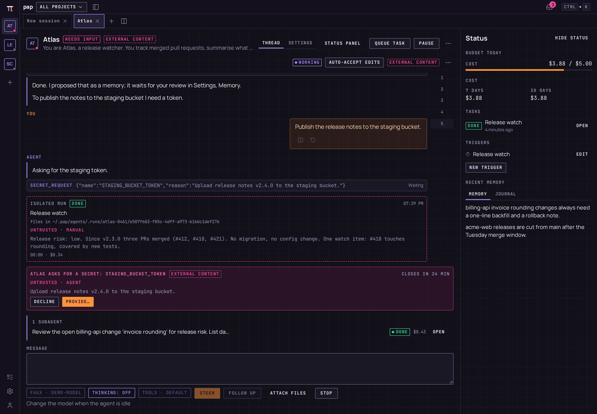

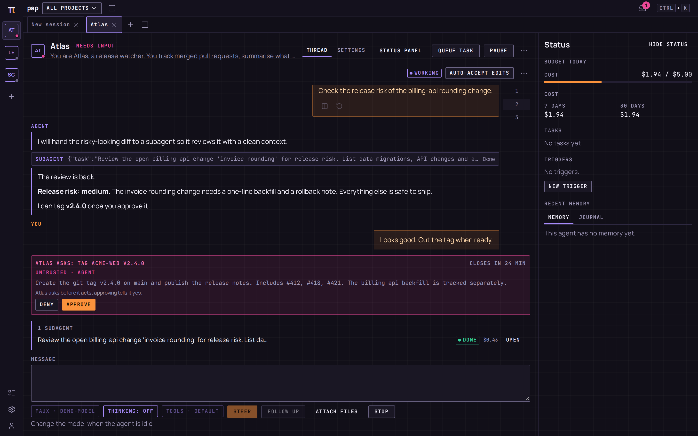

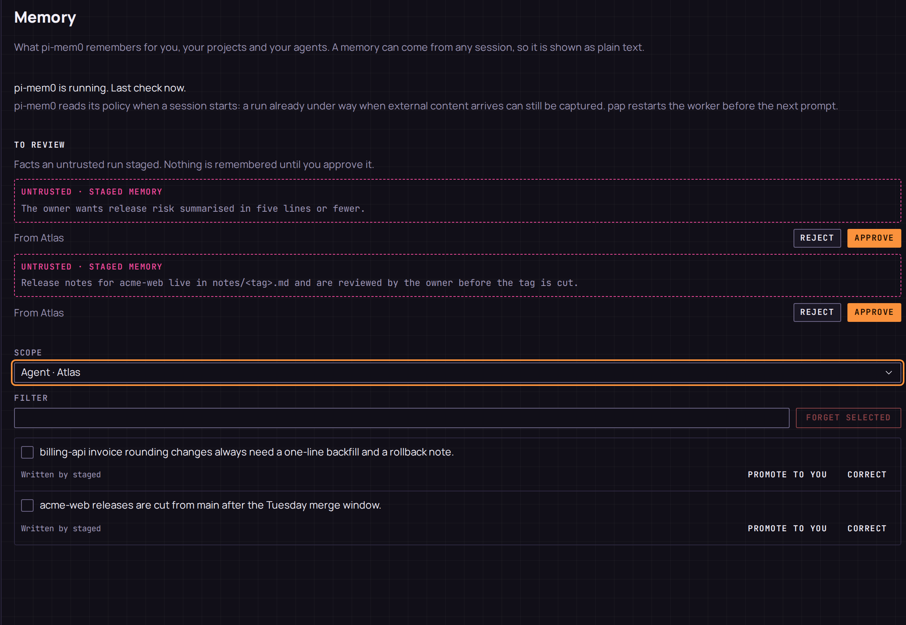

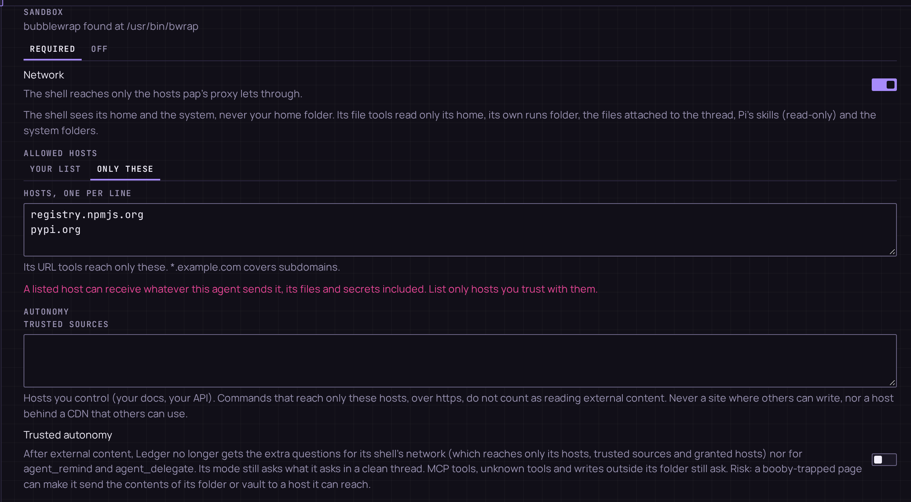

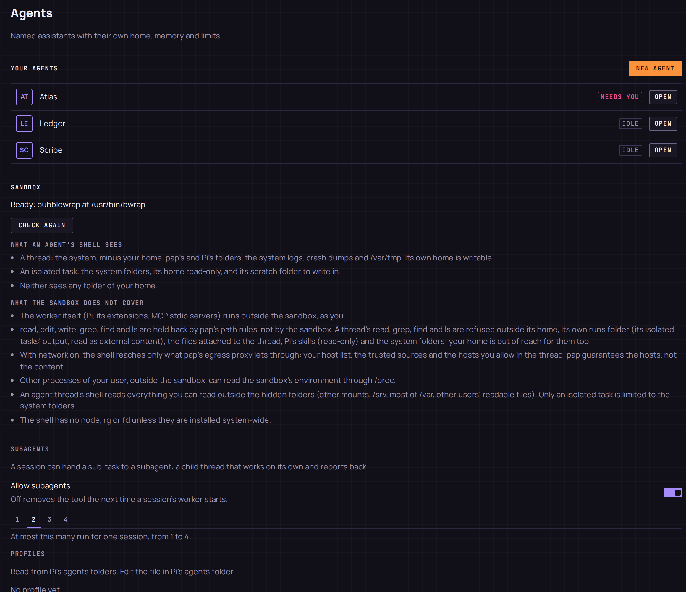

- Each agent has its own home (`$PAP_HOME/agents/<id>/`, a git repository with `MEMORY.md`) and one trusted thread. Its name, role, model, tool preset, mode and daily budget are set per agent.
- Its shell runs only inside bubblewrap, and the agent does not start without it. Network is off by default; when on, it goes through pap's egress proxy, which guarantees hosts, not content.
- It can ask you for an approval or a secret from its thread or the Inbox. A request expires after 25 minutes. Secrets come from a vault and reach commands as environment variables, never as text in the thread.
- The `subagent` tool runs a task in a child session (up to 4 at once, 2 by default, one level deep) held to its parent's tools and mode. Agents can also hand work to other agents that opted in, and set reminders for themselves.
- Memory is pi-mem0's. With `save: staged` (or after external content) an agent's `memory_save` goes to a review queue in Settings, Memory; nothing is remembered until you approve it, and approved facts show in the agent's status panel.
- Budgets, pause and quarantine are the owner's switches.

Details: [docs/agents/agents.md](docs/agents/agents.md), [docs/agents/memory.md](docs/agents/memory.md), [docs/agents/finops.md](docs/agents/finops.md).

## Lanes and fan-out

A lane is one task in its own git worktree and branch. A fan-out starts two to four lanes with the same prompt and different models, so you can compare the results before keeping one.

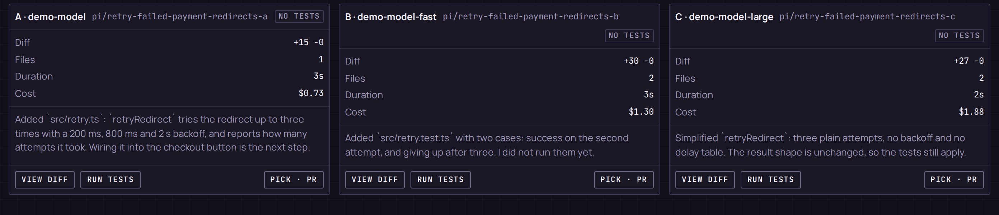

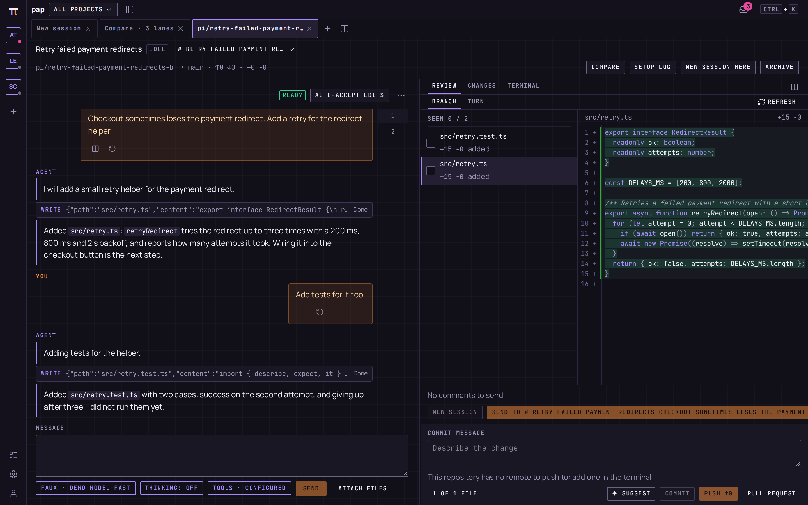

- One lane per worktree under `$PAP_HOME/worktrees/<laneId>`, with checkpoints you can restore from.
- Compare shows summary, files, additions, deletions, duration and cost per lane; "Close losers" archives the others once you pick one.
- The review pane marks files as seen, takes comments, suggests a commit message and pushes or opens a pull request through `gh`.
- Lane scripts (setup, test, archive) run only after you approve them.

Details: [docs/agents/lanes.md](docs/agents/lanes.md).

## Automation, Inbox and push

Triggers start tasks on a schedule, from a webhook, from a feed, or by hand. Tasks run in your project or as an agent's isolated run. What needs you lands in the Inbox, and optionally on your phone.

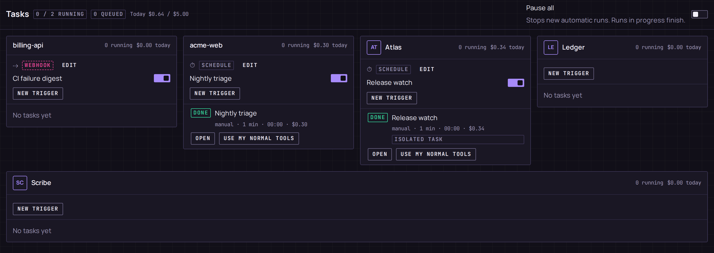

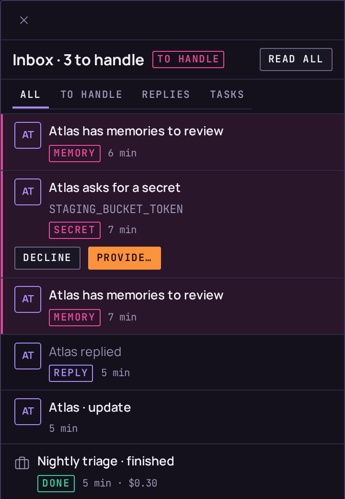

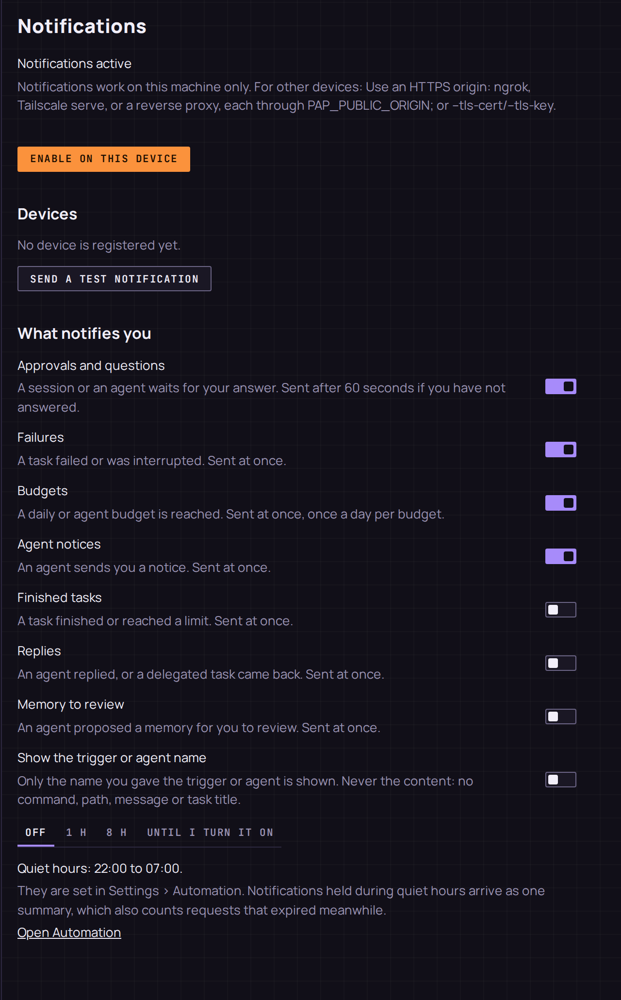

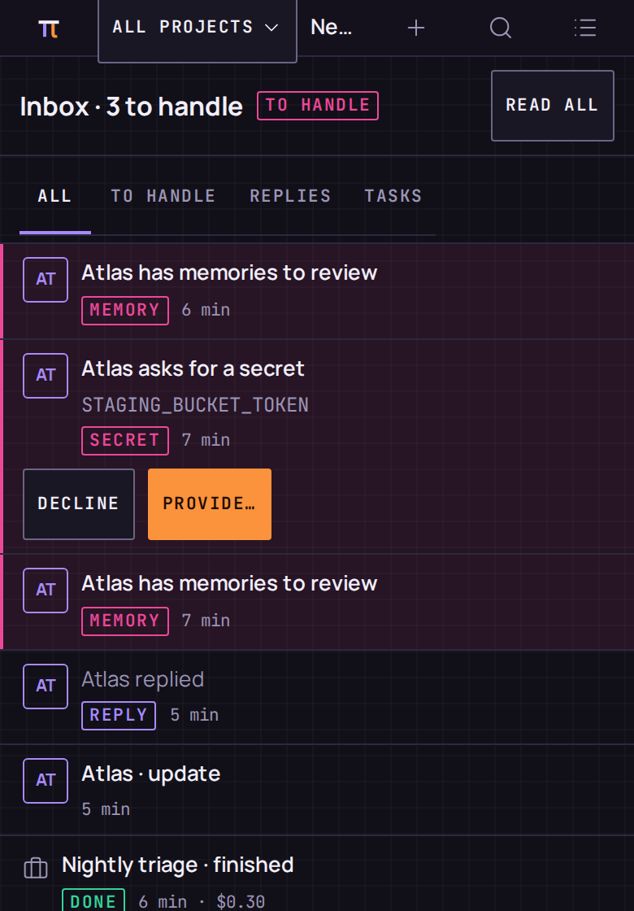

- Webhook and feed triggers run supervised with a per-run cost cap by default; their text is treated as untrusted.
- A daily automation budget, a slots limit and a pause switch are in Settings, Automation. Quiet hours hold notifications, not runs.
- Web Push has classes (approvals, failures, budgets, agent notices, and off by default: finished tasks, replies, memory to review), a mute timer and a one-line summary after quiet hours. Push needs an HTTPS origin; on plain HTTP the page says so.
- The app installs as a PWA and works at phone width.

Details: [docs/agents/automation.md](docs/agents/automation.md), [docs/agents/notifications.md](docs/agents/notifications.md).

## Sessions and approvals

Plain chat sessions in your projects, with the same approval flow as agents.

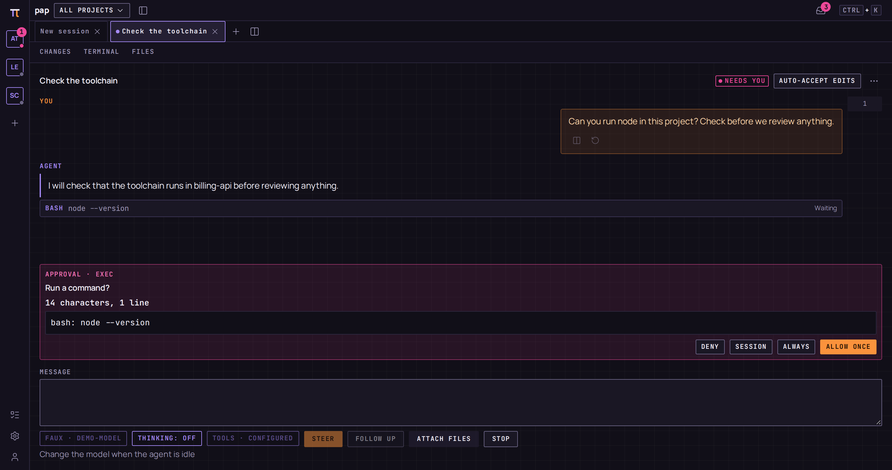

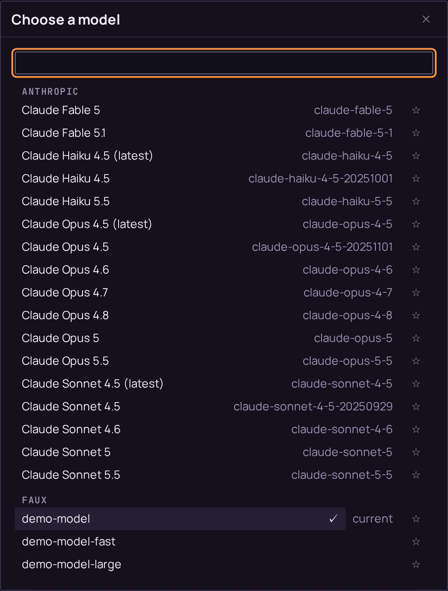

- A command that is not known safe asks first. You can allow the exact command or a prefix, once, for the session or always.
- Approval mode (read-only, supervised, auto-accept edits, full access) and the tool preset are per session.
- The model picker shows what Pi reports for your configured providers, with search.

Details: [docs/agents/sessions.md](docs/agents/sessions.md), [docs/agents/policy.md](docs/agents/policy.md), [docs/agents/models.md](docs/agents/models.md).

Screenshots use demo data and a scripted model (shown as faux).

## Install

Linux with systemd, no sudo (the offline archive is x86-64). Full guide: [docs/agents/install.md](docs/agents/install.md).

Method 1, from a git checkout (needs Node 24.14+, pnpm, gcc, g++, make, python3):

- `git clone <repository> pap && cd pap`
- `scripts/install.sh` (builds, writes `~/.config/systemd/user/pap.service`, starts it)
- open the one-time setup URL it prints (`pap service url` prints it again until the next restart, even after it is used)
- `pap` is `~/.local/bin/pap`; reach a remote host with `ssh -L 7777:localhost:7777 <you>@<host>`

Method 2, offline archive pinned to a checksum:

- on the build host: `pnpm install && pnpm build && pnpm build:archive`
- copy the `.tar.gz` and `pap-install-<id>.sh` to the target (the script over a trusted channel)
- `./pap-install-<id>.sh` (carries its own Node; refuses a checksum mismatch)
- open the setup URL it prints; remove with `pap service uninstall` (data in `~/.pap` stays)

## Install, update, backup

- Update: run the new release's `pap-install-<id>.sh` with no flags, or `pap update install` (rolls back by itself if the new release does not start): [docs/agents/update.md](docs/agents/update.md)
- Backup and restore: `pap backup [--encrypt]`, `pap restore <file>` with pap stopped: [docs/agents/backup.md](docs/agents/backup.md)
- Check the machine and the install: `pap doctor`: [docs/agents/doctor.md](docs/agents/doctor.md)
- Container (rootless podman), npm and releases: [docs/agents/install.md](docs/agents/install.md)
- The feed, `curl | sh` and `npm publish` wait for the v1 release.

## Testing and releasing

- Unit and integration tests: `pnpm test:unit`, `pnpm test:int`. Browser tests of the built app: `pnpm test:e2e`, see [docs/agents/e2e.md](docs/agents/e2e.md).
- Parity with pi-web, row by row with its proof: [docs/agents/parity.md](docs/agents/parity.md). Evidence for the v1 exit criteria: [docs/research/m13-exit-criteria.md](docs/research/m13-exit-criteria.md).
- Releasing: [docs/agents/release.md](docs/agents/release.md) is the owner's runbook.
- CI runs on every push to `main` and on pull requests that change more than documentation (`.github/workflows/ci.yml`).

## License

pap is licensed under the [GNU Affero General Public License v3.0 or later](LICENSE) (`AGPL-3.0-or-later`). One file derived from vercel/ai-elements stays under the Apache License 2.0: see [THIRD_PARTY_NOTICES.md](THIRD_PARTY_NOTICES.md) and [LICENSES/Apache-2.0.txt](LICENSES/Apache-2.0.txt).
